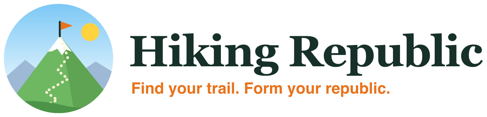

<a href="https://hikingrepublic.org"><picture>
  <source media="(prefers-color-scheme: dark)" srcset="wordmark-dark.png">
  
</picture></a>

<b>Find your trail. Form your republic.</b> A worldwide community of hikers, born in Switzerland.

  <a href="https://hikingrepublic.org">🌍 Website</a> ·
  <a href="https://hikingrepublic.org/hikes/">🥾 Hikes</a> ·
  <a href="https://hikingrepublic.org/start/">🌱 Start Hiking</a> ·
  <a href="https://github.com/HikingRepublic/hikes/issues/new?template=suggest-a-hike.yml">✍️ Suggest a hike</a>

---

### What is Hiking Republic?

A home for people who'd rather be outside. We share hikes for every season, from flat lakeside walks with a pram to knife-edge ridges, each with a GPX track, honest stats and public transport to the trailhead. We also help beginners take their first steps, and help hikers find each other.

- **Hikes for four seasons:** spring blossom, high summer, golden larches and snowy winter trails
- **For everyone:** beginner, medium and advanced routes, plus family, pram-friendly and trail-running routes
- **Beginner guides:** trail etiquette, knowing your limits, and why turning around is always OK
- **Community:** clubs, Meetup groups and second-hand gear, so you can find your hiking buddies

### Get involved

We started in Switzerland, but the republic has no borders. **[Suggest a hike](https://github.com/HikingRepublic/hikes/issues/new?template=suggest-a-hike.yml)** from anywhere in the world. A trail you love, a hidden lake, a hut with the best rösti.

Built with ❤️ by <a href="https://danlemon.com">Dan Lemon</a> and friends.
